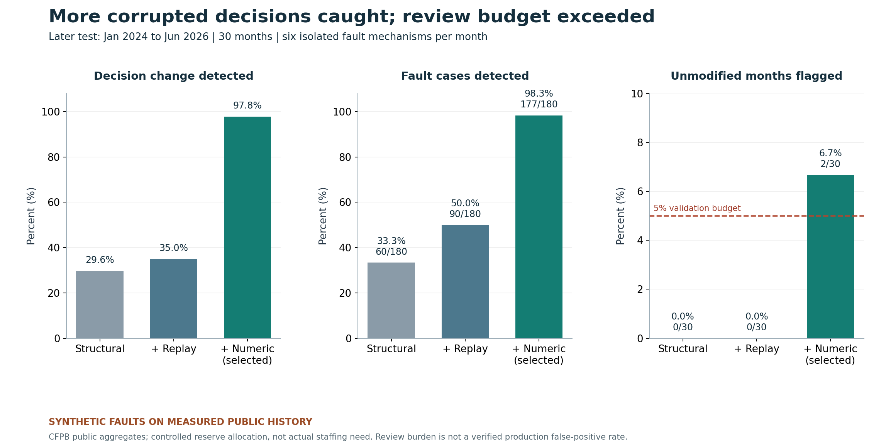
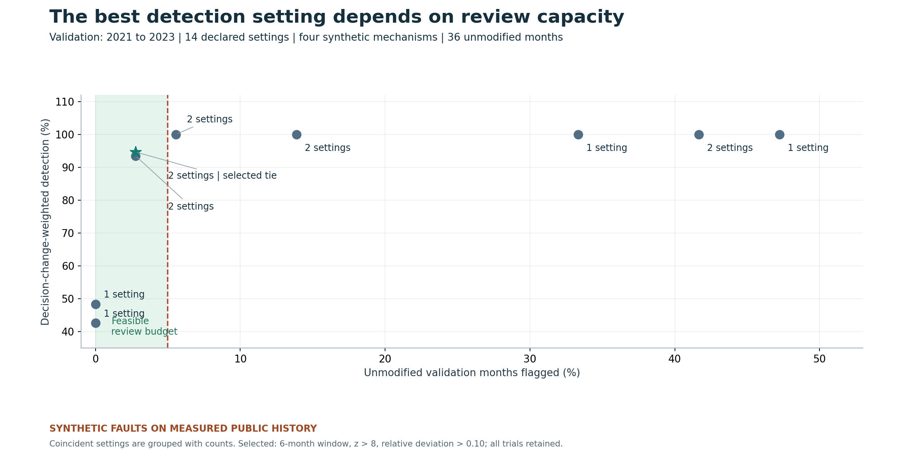
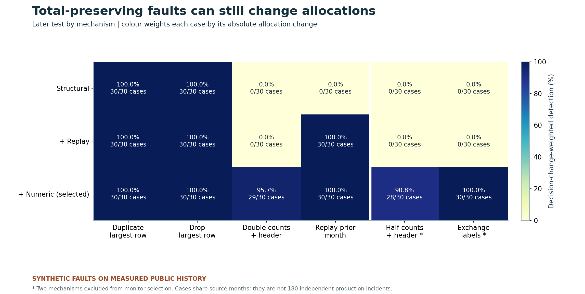

# Pipeline checks judged by the decisions they protect

**A feed can reconcile perfectly and still change the wrong allocation.** This controlled study asks which checks catch that failure, and how much additional review they create. Original Python and SQL reproduce a finite monitor search, every injected fault and each resulting allocation change.

The selected monitor detects **97.8% of absolute allocation change** across 180 later synthetic faults, compared with 29.6% for the declared structural checks. It flags **177/180 faults**, including 58/60 cases from two mechanisms excluded from selection. The cost matters: it also flags **2/30 unmodified months (6.7%)**, exceeding the 5% validation review budget. These results support a monitored trial with a real review-capacity constraint, not an unattended production rollout.



## The decision and its limits

The policy is explicit: reserve, by product category, the ceiling of the mean of the current and previous two monthly complaint counts. We compare that reference vector with the vector produced by a corrupted current batch. This is an **analytical allocation proxy**, not measured staffing need, actual loss, prevented harm or realized savings.

Historical counts are measured public CFPB aggregates. **All faults are synthetic.** No real production incident labels or fault prevalence are available. Unmodified-history flags measure review burden; they are not a verified production false-positive rate. Each fault is isolated against clean earlier history, so no cumulative recovery behavior is tested.

| Later test, Jan 2024 to Jun 2026 | Structural | Structural + replay | Selected numeric monitor |
|---|---:|---:|---:|
| Faults detected / 180 | 60 | 90 | 177 |
| Decision-change-weighted detection | 29.65% | 34.96% | 97.79% |
| Remaining unflagged absolute allocation change | 1,013,707 | 937,193 | 31,875 |
| Unflagged decision MSE, averaged over all 180 faults | 5,785,281.72 | 5,285,421.87 | 144,043.42 |
| Unmodified months flagged / 30 | 0 | 0 | 2 |

The absolute-change totals sum repeated synthetic scenarios and are **not actual workload totals**. MSE is per-category squared divergence from the reference policy, not error against staffing ground truth. Among 157 scenarios exceeding the declared 5% materiality threshold, the selected monitor flags 154. Three scale faults are missed. No post-test retuning was performed.

## A finite search with a protected later case test

The [protocol](PROTOCOL.md) was committed before constructing and scoring these fault cases. It reuses an exact historical source panel previously used in a [different forecasting study](https://github.com/S3R3Bii/complaint-capacity-forecasting/tree/888c9d819cec605b3839e223bad7492846a00fa0). That source history was already seen; this is a new controlled fault experiment, not an independent source dataset or original-release evaluation.

Warm history is 2018 to 2020. Selection uses 36 months from 2021 to 2023, four synthetic fault families and corresponding unmodified batches. Fourteen candidates include structural-only, structural-plus-replay and 12 numeric configurations: windows 6/12 months, z cutoffs 3/5/8 and relative-deviation cutoffs 0.10/0.25. Numeric checks use strictly earlier category counts, median log-count deviations and a declared robust scale floor.

The objective maximizes allocation-change-weighted detection subject to at most 5% unmodified-month flags, with lower burden and then name resolving ties. The selected 6-month, z=8, relative=0.10 setting captures 94.64% of validation allocation change and flags 1/36 unmodified months. A tied relative=0.25 setting has identical validation metrics. The window and cutoff are grid boundaries: this is finite selection, **not proof of a global optimum**. No ML estimator was needed.



The selection was frozen in commit `463f92af887319e68b202066139e946d3c18e9f6` before the later synthetic cases were scored. The later test adds halved counts with a matching header and an exchange of the largest/smallest category labels. Both remain structurally valid. The selected monitor detects 58/60 held-family cases and 97.16% of their allocation change. It misses two half-scale cases and one double-scale case overall.



The paired gain over structural-only weighted detection is 68.14 percentage points; a 2,000-draw calendar-quarter block bootstrap gives a conditional 95% percentile interval of 63.94 to 71.95 points. Ten quarters, rather than 180 supposedly independent incidents, are the resampling units. The interval is conditional on these months and six declared mechanisms. It cannot establish general production reliability.

## Source, rights and provenance

- [CFPB Consumer Complaint Database](https://www.consumerfinance.gov/data-research/consumer-complaints/): 102 exact monthly aggregate JSON snapshots, Jan 2018 to Jun 2026. Six consistently named categories form 612 category-months; full original aggregate responses remain intact for total reconciliation. No individual complaints or narratives are included.
- [CFPB website policy](https://www.consumerfinance.gov/privacy/website-privacy-policy/): factual federal aggregates and source attribution are preserved; third-party rights are not relicensed and no endorsement is implied.
- [Source manifest](data/manifest.json) preserves exact queries, retrieval timestamps and SHA-256 hashes. [Upstream reconciliation](data/upstream_source_reconciliation.json) records the earlier independent whole-period check. Current historical values can incorporate reporting delays and revisions.
- [Deequ](https://github.com/awslabs/deequ) is context for declarative data-quality constraints. This compares **our stated check sets**, not Deequ's capabilities or another product benchmark. No Deequ code or source paper is redistributed.

## Reproduce and audit

Python 3.10 with [pinned dependencies](requirements.txt):

```sh
python -m pip install -r requirements.txt
python -m unittest discover -s tests -v
python src/verify.py validation
python src/verify.py test
python src/check_reproduction.py
```

The final command rebuilds validation, selection, later cases, metrics, bootstrap draws and figures in a separate temporary directory. It compares every candidate's validation objectives and required final outputs at absolute tolerance 1e-7 / relative 1e-9. Network access is unnecessary after checkout.

Independent verification does not import the experiment implementation. It reconstructs every mutation, uses SQL for batch grain/period/count/header contracts, rational arithmetic for every ceiling/allocation/MSE, separate array logic for all flags, and independently recomputes the winner and all 2,000 block draws. Seven contracts check reference immutability, future isolation, structurally valid decision-changing faults, grain failures, ties and optional-parameter exports. [All validation trials](results/search.csv), [final metrics](results/test_summary.json), [validation verification](results/verification_validation.json) and [test verification](results/verification_test.json) remain inspectable.

Two packaging/export corrections are retained in [correction records](results/corrections): optional CSV fields were fixed before test scoring; Git line-ending normalization was repaired to preserve exact source bytes. All 102 old/new source JSON semantic values were equal; no counts, selector, policy or result changed. Original checks are not erased.

## Next useful evidence

Establish the actual downstream allocation rule, a capacity-based review budget and confirmed real fault mechanisms with an authorized operational owner. Then freeze a new later-period evaluation. Recheck genuine demand shifts that currently trigger review, without tuning against this completed test. A larger synthetic recall number alone would not resolve the observed review-budget failure.

Private LaTeX/PDF manuscript drafts remain outside this repository. The public package contains original code, eligible aggregate data, derived figures and checks; no credentials, individual records or unpublished manuscripts.
